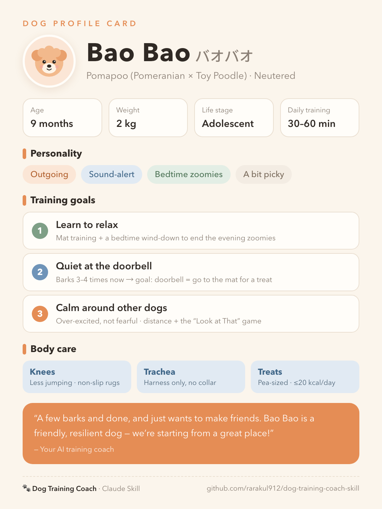
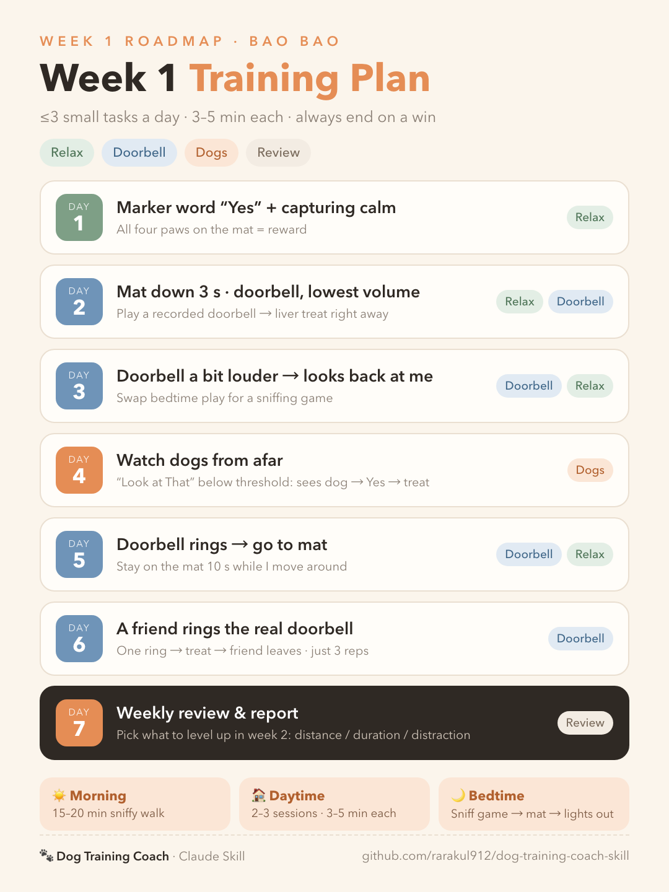

# 🐾 Dog Training Coach — a Claude Skill

Share your dog's profile and get a **personal AI dog-training coach** that guides you day by day in a **training-diary** format, from puppyhood to the senior years, while helping you build a better relationship with your dog.

> **English** · [日本語](#日本語) · [中文](#中文)

## ✨ Features

- **Onboarding**: breed, age, weight, health, home, and problem behaviors → a **Dog Profile Card** + a **Week-1 roadmap**
- **Training diary**: up to 3 daily tasks, each with clear steps, a success criterion and a fallback plan, plus a daily "relationship tip" for the owner. Difficulty adapts to your feedback (the 3 Ds: distance, duration, distraction)
- **Every life stage**: new arrival → puppy socialization → adolescence → adult → senior (including canine cognitive dysfunction signs)
- **Breed groups**: herding, working/guardian, hounds, retrievers, terriers, toy, brachycephalic, Japanese breeds, giant breeds, mixed and rescue dogs
- **Behavior protocols**: doorbell barking, jumping up, puppy biting, leash pulling, reactivity to other dogs, separation anxiety, resource guarding, house training, recall, fears, and senior night-time restlessness
- **Gear and food lists**: purpose, what to look for, recommended ingredients and ones to avoid, calorie budgeting, and a toxic-food checklist
- **Weekly progress reports**

## 🧭 Philosophy

Built on **positive reinforcement and animal welfare (the LIMA principle: Least Intrusive, Minimally Aversive)**. It draws on these trainers:

| Trainer | Adopted | Not adopted |
|---|---|---|
| Emily Larlham (Kikopup) | Positive reinforcement, capturing calm, impulse control (core) | — |
| Grisha Stewart (BAT) | Working under threshold, giving the dog choice, reactivity (core) | — |
| MASUMI (Doggies 911) | Observing the dog, owner mindset, the human–dog relationship | — |
| Cesar Millan | A calm owner, clear boundaries, exercise before training | Dominance/"alpha" theory, physical corrections |
| Tom Davis (No Bad Dogs) | Consistent rules, real-life interventions | Correction collars (prong, etc.) |
| Larry Krohn | Real-world training, relationship building | E-collars |

> This is an independent learning project. It is not affiliated with or endorsed by any of the trainers or organizations above.

## 📦 Installation

**Claude Code**

```bash
git clone https://github.com/rarakul912/dog-training-coach-skill.git
cp -R dog-training-coach-skill/dog-training-coach ~/.claude/skills/
```

**Claude.ai / Claude desktop app**: zip the `dog-training-coach` folder and upload it under Settings → Capabilities → Skills.

## 🚀 Usage

Just tell Claude about your dog:

```
Help me train my dog. Name: Bao, Pomapoo, 9 months, neutered, 2 kg.
We live in a small apartment. Bao barks when the doorbell rings
and gets over-excited and pulls toward other dogs.
```

Then report back each day ("Barked at the door again, but only twice today"), and the coach writes the next diary entry. The coach replies in your language (English, Japanese, Chinese and more).

## 🖼 Example

The profile card and week-1 plan the coach made for Bao Bao, a 9-month-old Pomapoo:

<p>
  
  
</p>

## 📁 Structure

```
dog-training-coach/
├── SKILL.md                     # Coaching workflow and principles
├── references/
│   ├── philosophies.md          # Trainer philosophies compared
│   ├── life-stages.md           # Life-stage guide
│   ├── breeds.md                # Breed-group notes
│   ├── behavior-protocols.md    # Behavior protocols
│   └── gear-and-food.md         # Gear, treats, food, toxic foods
└── assets/
    └── diary-template.md        # Profile card / diary / weekly report templates
```

The skill's internal reference files are written in Chinese. Claude reads them and answers in whatever language you use.

## ⚠️ Disclaimer

This skill gives general training guidance. It is not a substitute for veterinary diagnosis or professional behavior consultation. If there are bites, aggression toward children, self-injury, or sudden behavior changes, please contact a veterinarian or a certified behavior professional.

---

## 日本語

犬のプロフィールを伝えるだけで、**専属の AI ドッグトレーニングコーチ**が「トレーニング日記」形式で毎日の練習をサポートし、飼い主と犬の関係づくりを手伝う Claude Skill です。

**主な機能**
- プロフィールカードと第 1 週のトレーニング計画の作成
- 毎日の日記：課題は 3 つまで。手順、成功の目安、うまくいかない時の代替案、飼い主向けの「関係づくりのヒント」付き
- 子犬からシニア犬までのライフステージ別ガイド、犬種グループ別のポイント
- 無駄吠え（インターホン）、飛びつき、甘噛み、引っ張り、他の犬への反応、分離不安、食器の守り、トイレ、呼び戻しなどの対応プラン
- 道具・おやつ・フードのリスト（おすすめの成分、避けたい成分、カロリー管理、危険な食べ物）

**考え方**：陽性強化と動物福祉（LIMA 原則）が基本です。Kikopup（Emily Larlham）、Grisha Stewart（BAT）、MASUMI（Doggies 911）を中心に、Cesar Millan・Tom Davis・Larry Krohn の考え方は取り入れる部分と取り入れない部分を分けて参考にしています。上記トレーナーや団体とは関係のない個人のプロジェクトです。

**インストール**：上の「Installation」を参照してください。使うときは日本語でそのまま話しかければ、日本語で返答します。

**注意**：一般的なトレーニングのアドバイスであり、獣医師の診断や専門家の行動カウンセリングの代わりにはなりません。

---

## 中文

只要提供狗狗的资料，就会得到一位**专属 AI 训犬教练**。它以「训犬日记」的形式陪你每天训练，并帮助调节人与狗的关系。

**主要功能**
- 生成《犬只档案卡》和第 1 周训练路线图
- 每日日记：任务不超过 3 项，附步骤、成功标准、失败时的降级方案和「关系小课堂」，并根据你的反馈调整难度
- 覆盖幼犬到老龄犬的各个生命阶段，以及各犬种群的要点
- 问题行为方案：门铃吠叫、扑人、咬手、暴冲、对狗反应、分离焦虑、护食、厕所、召回等
- 道具、零食、主食清单：推荐成分、要避开的成分、热量控制、有毒食物提醒

**理念**：以正向强化与动物福祉（LIMA 原则）为底线。以 Kikopup（Emily Larlham）、Grisha Stewart（BAT）、MASUMI（Doggies 911）为主干，对 Cesar Millan、Tom Davis、Larry Krohn 的理念区分「采用」与「不采用」。本项目为个人整理，与上述训犬师及其机构无关。

**安装**：见上方「Installation」。直接用中文对 Claude 说话，它就会用中文回复。

**示例**：[犬只档案卡](images/baobao-profile.png) · [第 1 周路线图](images/baobao-roadmap.png)

**免责声明**：本 Skill 提供一般性训练建议，不能代替兽医诊断或专业行为咨询。

---

## License

[MIT](LICENSE)
